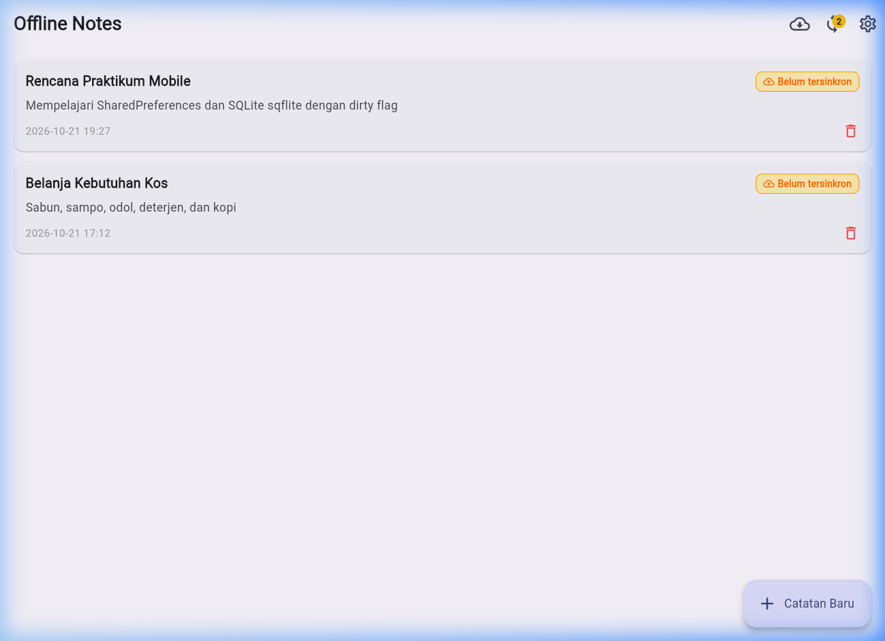
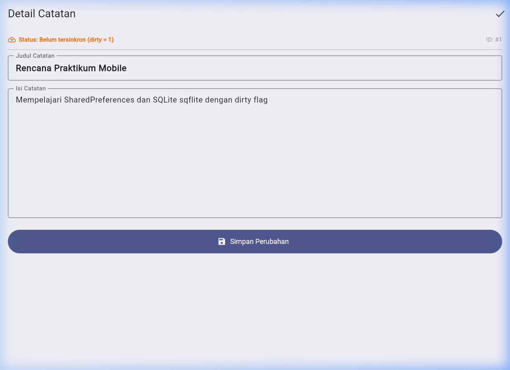
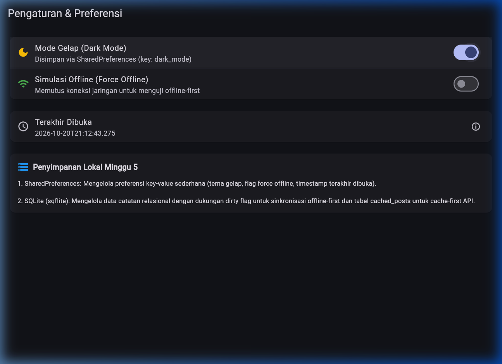
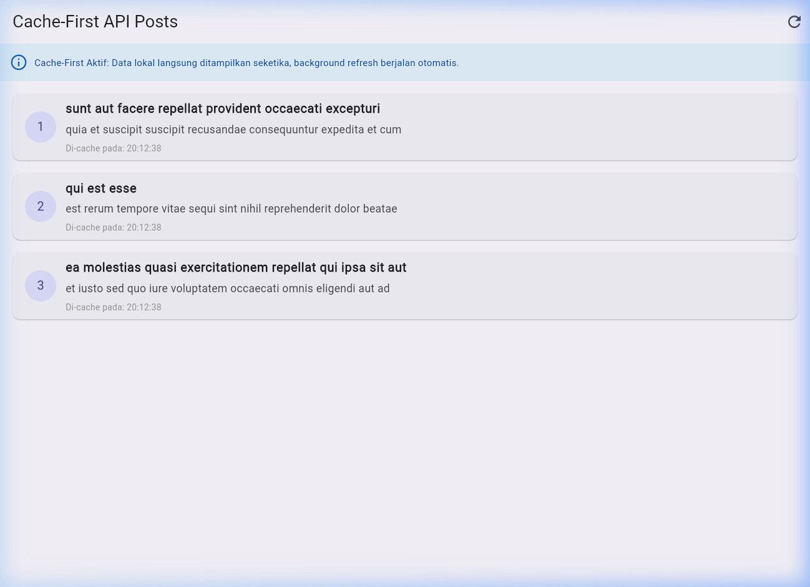
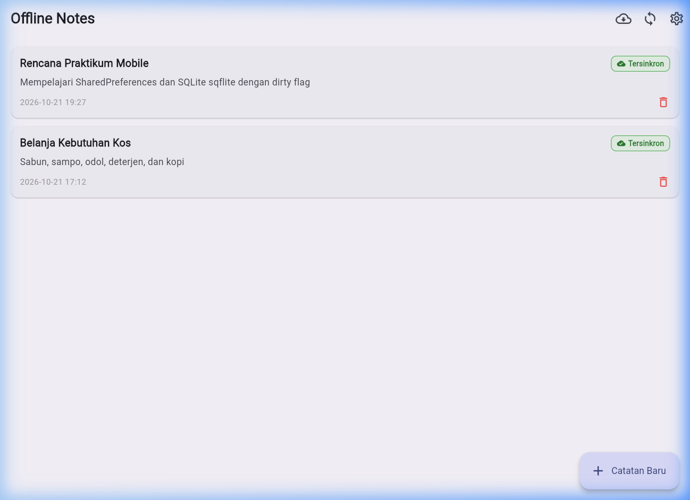

# Praktikum 5 - Local Storage & Offline-First

Project Flutter ini berisi implementasi menyeluruh materi Week 5: penyimpanan lokal key-value menggunakan `SharedPreferences`, basis data relasional menggunakan `SQLite` (`sqflite`), state management terpusat dengan `Riverpod`, implementasi pola arsitektur **offline-first** (cache-first read, dirty flag, antrean sinkronisasi, dan resolusi konflik *last-write-wins*), serta navigasi detail dengan `GoRouter`.

---

## Identitas Mahasiswa

| Data | Keterangan |
|---|---|
| **Nama** | Achmad Daud Roichan |
| **NIM** | 244107020005 |
| **Kelas** | TI 3F |
| **Mata Kuliah** | Pemrograman Mobile (Mobile Programming) |
| **Praktikum** | Praktikum 5 - Local Storage & Offline-First |

---

## Ringkasan Project

- **Penyimpanan Preferensi (Key-Value):** Menggunakan `SharedPreferences` untuk menyimpan status tema gelap (`dark_mode`), penanda waktu aplikasi terakhir dibuka (`last_opened_at`), dan switch simulasi offline (`force_offline`).
- **Penyimpanan Data Catatan (Relasional):** Menggunakan `SQLite` via package `sqflite` untuk menyimpan koleksi catatan dengan skema tabel terindeks, mendukung pengurutan waktu (`updated_at DESC`), dan penanda belum tersinkron (`dirty INTEGER NOT NULL DEFAULT 0`).
- **Pola Offline-First:**
  - *Cache-First Read:* Membaca data seketika dari tabel lokal `cached_posts` agar antarmuka tidak blank saat tanpa koneksi, lalu menjalankan refresh latar belakang ke JSONPlaceholder (`GET /posts`) saat online.
  - *Dirty Flag:* Setiap catatan yang dibuat atau diperbarui di perangkat lokal secara otomatis diberi penanda `dirty = 1`.
  - *Antrean Sinkronisasi (`syncNotes`):* Saat sinkronisasi dijalankan, aplikasi menghitung catatan kotor (`countDirty()`), menyimulasikan transmisi data ke server backend, dan memperbarui status menjadi `dirty = 0` (`markAllSynced()`).
  - *Resolusi Konflik:* Menerapkan aturan eksplisit *Last-Write-Wins* berbasis stempel waktu `updated_at`.
- **Navigasi Dinamis:** Menggunakan `GoRouter` untuk rute utama (`/`), detail catatan dinamis (`/note/:id`), pengaturan (`/settings`), dan cache-first API (`/cached-posts`).

---

## Struktur Project

```text
05-week-5-local-storage-offline-first/
├── README.md
├── analysis_options.yaml
├── pubspec.yaml
├── docs/
│   └── ai_challenge.md
├── screenshots/
│   ├── notes_offline_list.png
│   ├── note_detail.png
│   ├── settings_dark_mode.png
│   ├── cached_posts_cache_first.png
│   └── sync_success.png
├── lib/
│   ├── main.dart
│   ├── routes.dart
│   ├── data/
│   │   ├── prefs.dart
│   │   ├── sync.dart
│   │   ├── providers.dart
│   │   ├── local/
│   │   │   ├── db.dart
│   │   │   └── note.dart
│   │   └── repositories/
│   │       └── note_repository.dart
│   ├── pages/
│   │   ├── notes_page.dart
│   │   ├── note_detail_page.dart
│   │   ├── settings_page.dart
│   │   └── cached_posts_page.dart
│   └── widgets/
│       └── note_tile.dart
└── test/
    ├── note_test.dart
    └── widget_test.dart
```

---

## Dokumentasi Screenshot

Berikut adalah bukti dokumentasi visual hasil implementasi antarmuka dan pengujian skenario offline-first:

### 1. Daftar Catatan Offline dengan Penanda Dirty Flag
Menampilkan daftar catatan tersimpan lokal di SQLite saat mode pesawat / simulasi offline aktif. Catatan yang baru ditambahkan memiliki chip oranye **Belum tersinkron** dan badge counter pada AppBar:

<p align="center">
  
</p>

### 2. Halaman Detail dan Edit Catatan (`/note/:id`)
Halaman detail dibuka melalui parameter dinamis GoRouter dan membaca data langsung dari SQLite lokal secara independen dari state list:

<p align="center">
  
</p>

### 3. Pengaturan Preferensi dan Mode Gelap (SharedPreferences)
Pengaturan tema gelap, toggle simulasi force offline, dan pencatatan waktu aplikasi terakhir dibuka:

<p align="center">
  
</p>

### 4. Cache-First Read API Posts
Menampilkan data post yang langsung diambil dari tabel `cached_posts` di SQLite saat aplikasi dibuka, tanpa menunggu respons jaringan:

<p align="center">
  
</p>

### 5. Hasil Sinkronisasi Berhasil (`syncNotes`)
Setelah tombol sinkronisasi ditekan, catatan dirty disinkronkan, chip berubah menjadi hijau **Tersinkron**, badge counter kembali ke 0, dan SnackBar konfirmasi muncul:

<p align="center">
  
</p>

---

## Refactoring Challenge

Tiga tantangan refactoring dari codelab telah diselesaikan secara tuntas:

1. **Ekstraksi Widget `NoteTile`:**
   - Dibuat pada `lib/widgets/note_tile.dart`.
   - Widget menampilkan judul catatan, preview isi (maksimal 2 baris), format waktu yang rapi, tombol hapus, dan badge kondisional:
     - Jika `dirty == true`: chip oranye dengan ikon `cloud_upload` bertuliskan **Belum tersinkron**.
     - Jika `dirty == false`: chip hijau dengan ikon `cloud_done` bertuliskan **Tersinkron**.
2. **Pemisahan Logika Sinkronisasi ke `lib/data/sync.dart`:**
   - Memisahkan operasi batch caching `cached_posts`, pembacaan cache-first `loadPostsCacheFirst`, dan antrean pengiriman `syncNotes` keluar dari `NoteRepository`.
   - Menjaga prinsip *Single Responsibility Principle* (SRP) sehingga `NoteRepository` murni menangani CRUD catatan SQLite.
3. **Halaman Detail Catatan dengan GoRouter (`/note/:id`):**
   - Dibuat pada `lib/pages/note_detail_page.dart` dan didaftarkan pada `lib/routes.dart`.
   - Membaca data catatan langsung dari database melalui `repo.getNoteById(id)` sehingga tidak rapuh terhadap navigasi langsung atau *deep link*.

---

## AI Prompt Challenge & Verifikasi

Dokumentasi lengkap AI Challenge tersimpan pada file [`docs/ai_challenge.md`](docs/ai_challenge.md).

### Ringkasan Evaluasi Pilihan Penyimpanan

| Storage | Kompleksitas Query | Relasi | Stream / Reaktivitas | Type-Safety | Boilerplate | Penggunaan Terbaik |
|---|---|---|---|---|---|---|
| **SharedPreferences** | Sangat Rendah (Key-Value) | Tidak Mendukung | Tidak Bawaan | Rendah | Sangat Kecil | Pengaturan tema, token, boolean toggle |
| **SQLite (`sqflite`)** | Tinggi (SQL murni) | Kuat (JOIN, FK, Index) | Dibantu Riverpod | Menengah | Sedang | Data terstruktur, catatan, dirty flag, offline cache |
| **Hive** | Rendah (NoSQL Box) | Manual Linking | Bawaan (`watch()`) | Menengah (TypeAdapter) | Sedang | Cache objek biner ringan, NoSQL embedded |
| **Drift** | Sangat Tinggi (Dart DSL) | Sangat Kuat | Sangat Kuat (`watch()`) | Sangat Tinggi (Code-Gen) | Besar (`build_runner`) | Aplikasi enterprise besar dengan relasi kompleks |

### Keputusan Teknis Final
Kombinasi **`SharedPreferences` + `SQLite (sqflite)`** dipilih karena:
- Menghormati batasan domain: SharedPreferences tidak membebani memori untuk data koleksi, sedangkan SQLite memberikan efisiensi query pengurutan waktu (`ORDER BY updated_at DESC`) dan seleksi dirty flag (`WHERE dirty = 1`).
- Setup deterministik tanpa memerlukan code generation berat (`build_runner`), sehingga waktu kompilasi dan testing sangat cepat.

---

## Jawaban Pertanyaan Analisis & Refleksi

### 1. Mengapa daftar catatan tidak boleh disimpan di SharedPreferences? Apa yang rusak jika aturan ini dilanggar?
> **Jawaban:**
> `SharedPreferences` (XML di Android atau plist di iOS) dirancang secara eksklusif untuk nilai primitif kecil (*scalar values*) seperti boolean, int, atau string pendek. 
> Jika daftar catatan disimpan sebagai satu string JSON besar di SharedPreferences:
> - **In-memory bloat:** Setiap kali preferensi diakses, seluruh file XML/plist dibaca ke memori. Koleksi 1000 catatan akan membebani RAM secara permanen.
> - **Tidak ada query parsial:** Untuk mengubah 1 catatan (misalnya menandai `dirty = 0`), seluruh koleksi catatan harus di-deserialize, diubah di memori, di-serialize ulang, dan ditulis kembali ke disk (*full disk rewrite*).
> - **Rawan Race Condition:** Operasi tulis simultan dapat menimpa data tanpa mekanisme transaksi atomik (ACID) yang dimiliki oleh SQLite.
> - **Ketiadaan Pengindeksan:** Tidak dapat melakukan operasi `ORDER BY updated_at DESC` atau `WHERE dirty = 1` di tingkat disk; semua pemfilteran terpaksa dilakukan secara manual di CPU aplikasi.

### 2. Kapan cache-first cukup, dan kapan Anda membutuhkan strategi lain (misalnya network-first)?
> **Jawaban:**
> - **Cache-First** sangat ideal untuk data yang perubahannya tidak instan (frekuensi pembaruan rendah hingga menengah) dan memprioritaskan pengalaman pengguna (*instant UI rendering* tanpa blank screen/loading spinner), contohnya: feed artikel, daftar pengumuman kampus, postingan blog, profil pengguna, dan katalog produk.
> - **Network-First** wajib digunakan ketika data tersebut memiliki sensitivitas tinggi terhadap kebaruan (*real-time critical*) atau menyangkut transaksi moneter, contohnya: harga saham/kripto, ketersediaan kursi tiket pesawat, saldo rekening perbankan, dan status pembayaran checkout. Pada skenario ini, menampilkan data basi (*stale data*) bahkan selama beberapa detik dapat menyebabkan salah transaksi fatal.

### 3. Bagaimana dirty flag berubah menjadi antrean sync tanpa memblokir UI? Kapan antrean terpisah (tabel outbox) menjadi perlu?
> **Jawaban:**
> - **Operasi Non-Blocking:** Di Flutter/Dart, proses sinkronisasi dijalankan secara *asynchronous* melalui `Future` di event loop atau isolate terpisah. UI tetap responsif 60/120 FPS karena pembacaan dan penulisan status ke SQLite menggunakan pool koneksi asynchronous.
> - **Kapan tabel Outbox terpisah diperlukan?**
>   - Dirty flag pada tabel entitas hanya cukup jika operasinya adalah *create* atau *update* sederhana dengan model *full object replacement*.
>   - **Tabel Outbox terpisah** (`mutation_queue` / `outbox`) mutlak diperlukan ketika:
>     1. Aplikasi perlu mencatat *urutan mutasi terperinci* (misalnya: Buat Catatan -> Edit Judul -> Tambah Tag -> Hapus Catatan). Jika catatan dihapus saat offline, row di SQLite hilang sehingga tidak ada dirty flag yang bisa dikirim ke server tanpa tabel outbox.
>     2. Operasi membutuhkan payload HTTP method eksplisit (`POST`, `PUT`, `DELETE`).
>     3. Memerlukan pelacakan *retry backoff count* dan pesan error spesifik per operasi yang gagal.

### 4. Bagian mana dari rekomendasi AI yang Anda tolak, dan mengapa?
> **Jawaban:**
> - **Penolakan Opsi SharedPreferences untuk Catatan:** AI sempat menyarankan menyimpan JSON array catatan di SharedPreferences untuk simplisitas awal. Opsi ini kami tolak karena melanggar prinsip skalabilitas dan integritas data.
> - **Penolakan Skema CRUD Polos tanpa Dirty Flag:** Prompt awal AI menghasilkan skema SQLite standar (`id`, `title`, `body`). Kami mengoreksi dan menambahkan kolom `updated_at TEXT NOT NULL` dan `dirty INTEGER NOT NULL DEFAULT 0` beserta indeks untuk mendukung antrean sinkronisasi offline-first.
> - **Penyederhanaan Reaktivitas:** AI sempat mengusulkan migrasi ke Drift hanya demi mendapatkan stream bawaan. Kami menolak karena penambahan dependensi `build_runner` menambah waktu build secara drastis, sedangkan Riverpod `ref.invalidate(notesProvider)` sudah memberikan reaktivitas UI yang sempurna dengan kode yang jauh lebih ringkas.

---

## Cara Menjalankan Project

1. Masuk ke direktori project Week 5:
   ```powershell
   cd 05-week-5-local-storage-offline-first
   ```
2. Ambil dependensi:
   ```powershell
   flutter pub get
   ```
3. Jalankan pengujian otomatis dan analisis kode:
   ```powershell
   flutter analyze
   flutter test
   ```
4. Jalankan aplikasi pada emulator atau web browser:
   ```powershell
   flutter run
   ```

---

## Hasil Verifikasi

Hasil eksekusi verifikasi statis dan pengujian unit pada terminal lokal:

```text
flutter analyze: No issues found!
flutter test: All tests passed! (6 tests passed)
```

Daftar test yang terverifikasi lulus:
- `Model Note & Serialisasi fromMap aman terhadap field yang hilang`
- `Model Note & Serialisasi flag dirty bertahan pada serialisasi`
- `Provider dengan FakeNoteRepository provider sukses dengan repository palsu`
- `Provider dengan FakeNoteRepository provider error dengan repository palsu`
- `Sinkronisasi Offline-First syncNotes menandai semua catatan kotor dan mengembalikan jumlahnya`
- `Widget test NoteTile menampilkan badge Belum tersinkron & Tersinkron`

---

## Referensi

- [Slide Week 5: Local Storage & Offline First](https://jti-polinema.github.io/flutter-codelab/00-slides/Week_05_Local_Storage_Offline_First.html)
- [Codelab Week 5 - Local Storage & Offline First](https://jti-polinema.github.io/flutter-codelab/05-minggu-5-local-storage-offline-first/)
- [Flutter Cookbook: Store key-value data](https://docs.flutter.dev/cookbook/persistence/key-value)
- [sqflite Package Documentation](https://pub.dev/packages/sqflite)
- [Riverpod Documentation: AsyncNotifier](https://riverpod.dev/docs/concepts/async_notifiers)
