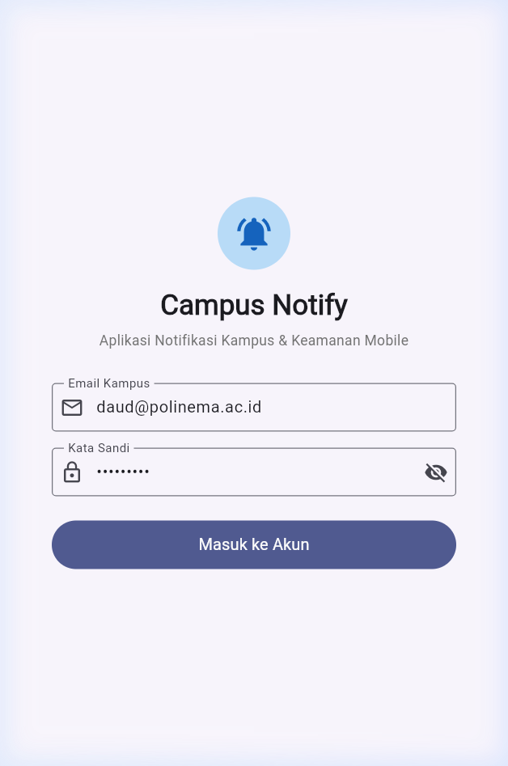
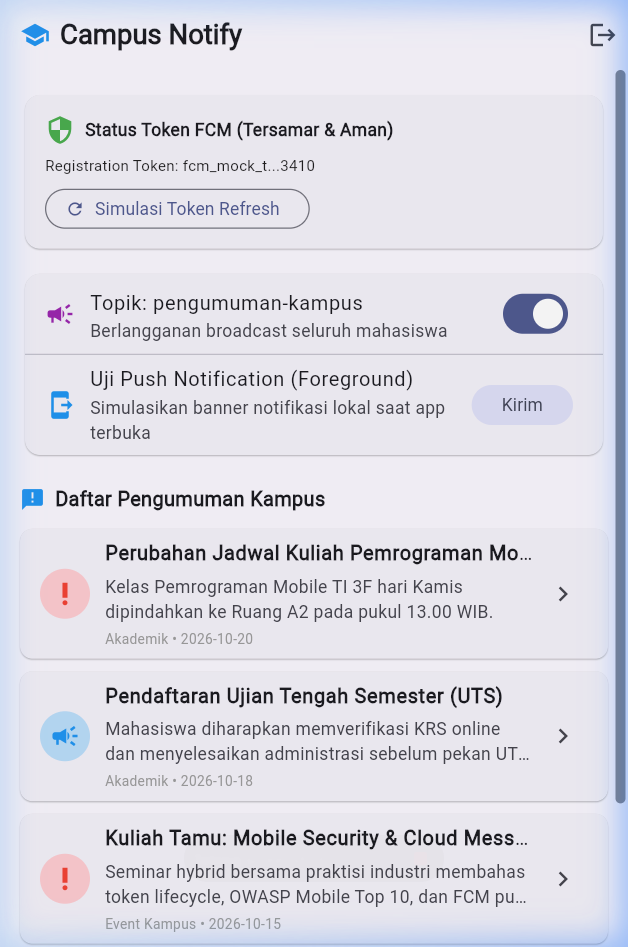
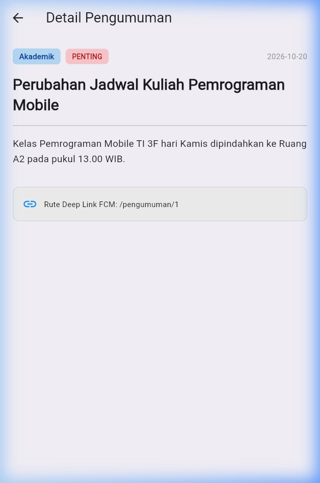
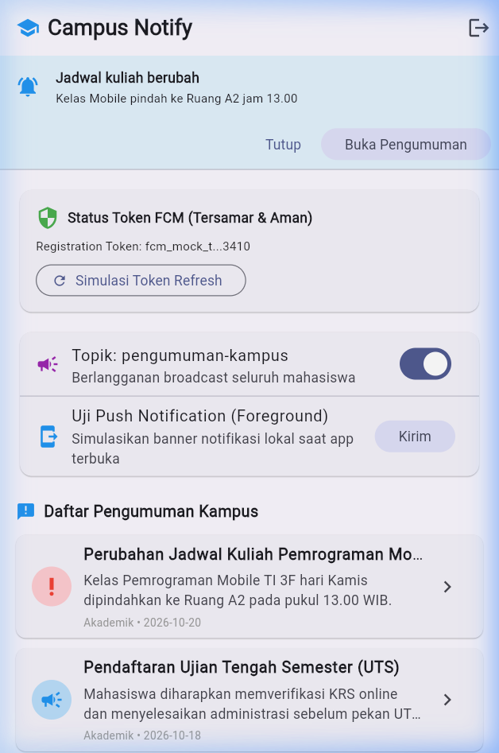
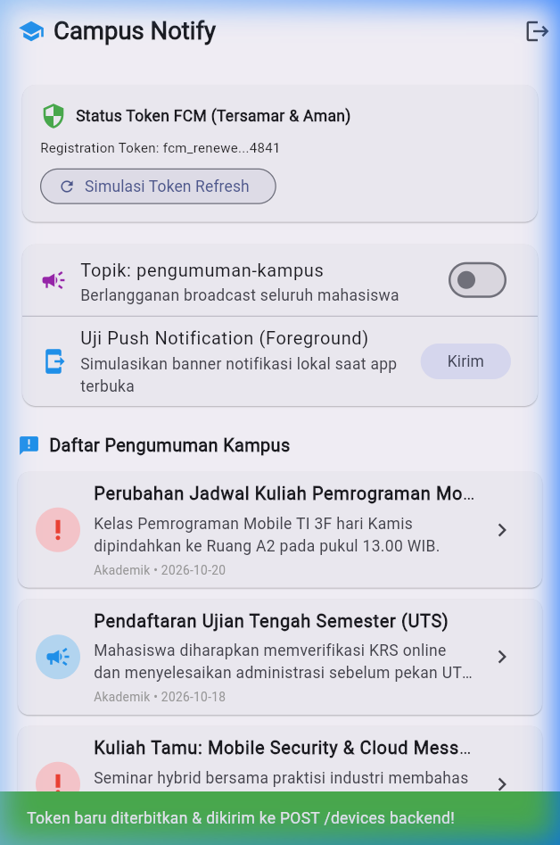

# Praktikum 6 - Authentication, Security & FCM

Project Flutter ini berisi implementasi menyeluruh materi Week 6: autentikasi aman dengan *secure storage*, siklus hidup token (*access token* dan *refresh token* dengan mekanisme auto-refresh saat 401 Unauthorized), arsitektur *Firebase Cloud Messaging* (FCM), perlakuan *notification payload* vs *data payload* di tiga app state, serta navigasi *deep linking* menggunakan `GoRouter`.

---

## Identitas Mahasiswa

| Data | Keterangan |
|---|---|
| **Nama** | Achmad Daud Roichan |
| **NIM** | 244107020005 |
| **Kelas** | TI 3F |
| **Mata Kuliah** | Pemrograman Mobile (Mobile Programming) |
| **Praktikum** | Praktikum 6 - Authentication, Security & FCM |

---

## Ringkasan Project

- **Arsitektur Autentikasi Aman:** Menggunakan `TokenStore` berbasis `flutter_secure_storage` yang terenkripsi di tingkat perangkat keras (Android KeyStore dan iOS Keychain). Akses dan refresh token tidak pernah disimpan di `SharedPreferences`.
- **Auto-Refresh Interceptor (Dio):** Saat API server mengembalikan status `401 Unauthorized`, interceptor Dio secara otomatis menukar refresh token menjadi access token baru, menyimpannya kembali ke secure storage, dan mengulang (*retry*) permintaan HTTP tepat satu kali tanpa logout paksa.
- **Guard Route GoRouter:** Menjaga rute secara reaktif; pengguna yang belum login secara otomatis diarahkan ke `/login`, dan pengguna yang sudah login dialihkan langsung ke dashboard `/`.
- **Firebase Cloud Messaging (FCM) & Deep Linking:**
  - Menangani siklus hidup token registrasi (`getToken` dan listener `onTokenRefresh` yang disinkronkan ke backend).
  - Menyediakan penanganan payload gabungan (*notification + data*):
    - **Foreground:** Banner ditampilkan secara manual melalui `flutter_local_notifications` karena sistem Android/iOS tidak memunculkan banner otomatis saat aplikasi sedang aktif.
    - **Background:** Banner sistem otomatis muncul, klik membuka rute target via `FirebaseMessaging.onMessageOpenedApp`.
    - **Terminated:** Aplikasi tertutup dibuka langsung ke detail pengumuman melalui `FirebaseMessaging.instance.getInitialMessage()`.
  - Topik siaran kampus: Berlangganan topik `pengumuman-kampus` untuk pengumuman massal seluruh mahasiswa.

---

## Struktur Project

```text
06-week-6-authentication-security-fcm/
├── README.md
├── analysis_options.yaml
├── pubspec.yaml
├── docs/
│   └── ai_challenge.md
├── screenshots/
│   ├── login_page.png
│   ├── home_announcements.png
│   ├── announcement_detail_deeplink.png
│   ├── foreground_notification_banner.png
│   └── token_refresh_debug.png
├── lib/
│   ├── main.dart
│   ├── routes.dart
│   ├── core/
│   │   └── format.dart
│   ├── data/
│   │   ├── api_client.dart
│   │   ├── api_errors.dart
│   │   ├── auth_repository.dart
│   │   ├── token_store.dart
│   │   └── models/
│   │       └── announcement.dart
│   ├── messaging/
│   │   └── push_service.dart
│   ├── pages/
│   │   ├── announcement_page.dart
│   │   ├── home_page.dart
│   │   └── login_page.dart
│   └── providers/
│       └── auth_provider.dart
└── test/
    ├── auth_push_test.dart
    └── widget_test.dart
```

---

## Dokumentasi Screenshot

### 1. Halaman Login Akun Kampus (`/login`)
Antarmuka autentikasi dengan validasi email kampus (`@polinema.ac.id`) dan kata sandi minimal 6 karakter:

<p align="center">
  
</p>

### 2. Dashboard Pengumuman Kampus & Status Token FCM (`/`)
Menampilkan status token registrasi FCM yang disamarkan (*masked* sesuai standar OWASP), toggle langganan topik `pengumuman-kampus`, dan daftar pengumuman akademik:

<p align="center">
  
</p>

### 3. Detail Pengumuman Hasil Navigasi Deep Link (`/pengumuman/:id`)
Halaman detail pengumuman yang dibuka saat notifikasi diklik, membaca parameter route `/pengumuman/1`:

<p align="center">
  
</p>

### 4. Banner Push Notification Foreground
Simulasi banner notifikasi lokal saat aplikasi berada dalam keadaan terbuka (*foreground*):

<p align="center">
  
</p>

### 5. Rotasi dan Refresh Token Registrasi FCM
Indikasi pembaruan token baru melalui `onTokenRefresh` yang secara otomatis dikirimkan ke endpoint `POST /devices` backend:

<p align="center">
  
</p>

---

## Matriks Pengujian Tiga App State FCM

Pengujian perilaku notifikasi gabungan `notification + data` (`route: /pengumuman/1`):

| State Aplikasi | Perilaku Sistem | Handler yang Menangani | Hasil yang Dicapai |
|---|---|---|---|
| **Foreground** (Aplikasi sedang aktif terbuka) | Sistem tidak menampilkan pop-up secara otomatis | `FirebaseMessaging.onMessage` + `flutter_local_notifications` | Muncul banner notifikasi lokal; jika diklik membuka `/pengumuman/1`. |
| **Background** (Aplikasi di-minimize / tekan tombol Home) | Sistem Android memunculkan banner notifikasi di status bar | `FirebaseMessaging.onMessageOpenedApp` | Banner sistem ditekan, aplikasi kembali ke depan dan langsung membuka detail rute. |
| **Terminated** (Aplikasi dimatikan / swipe-close dari recent apps) | Sistem menampilkan banner notifikasi di status bar | `FirebaseMessaging.instance.getInitialMessage` saat startup | Aplikasi melakukan inisialisasi awal, router membaca pesan pertama, dan langsung membuka `/pengumuman/1`. |

---

## Refactoring Challenge

Tiga item refactoring dari modul praktikum telah diimplementasikan:

1. **Pemusatan Konstanta Rute di `lib/routes.dart`:**
   - Dideklarasikan class `AppRoutes` berisi konstanta rute `login`, `home`, dan `announcementDetail`.
   - Mengeliminasi duplikasi *magic string* di seluruh aplikasi.
2. **Ekstraksi Parsing Rute Murni `routeFromMessage()`:**
   - Fungsi murni independen di `lib/routes.dart` yang mengonversi `Map<String, dynamic>` menjadi format path yang valid (menangani input kosong dan otomatis menambahkan leading slash bila tidak ada).
   - Dapat diuji murni pada unit test tanpa bergantung pada framework Firebase.
3. **Pemisahan Pemetaan Error ke `lib/data/api_errors.dart`:**
   - Fungsi `friendlyErrorMessage()` memetakan status HTTP (401, 403, 404, 500), timeout, connection error, dan cancel menjadi pesan bahasa Indonesia yang mudah dipahami mahasiswa.

---

## AI Prompt Challenge & Verifikasi

Dokumentasi lengkap AI Challenge tersimpan pada file [`docs/ai_challenge.md`](docs/ai_challenge.md).

### Temuan Verifikasi Teknis
1. **Background Handler Top-Level:** Draf awal AI yang menaruh handler di dalam class ditolak karena Dart VM mengharuskan fungsi background bersifat top-level dengan anotasi `@pragma('vm:entry-point')`.
2. **Keamanan Token (OWASP Mobile Top 10):** Token tidak pernah dicetak utuh ke console log. Fungsi `PushService.maskToken()` memastikan hanya potongan aman (10 karakter awal dan 4 karakter akhir) yang dapat dilihat di layar debug.
3. **Penyimpanan Terenkripsi:** Access token dan refresh token diisolasi penuh di `FlutterSecureStorage`.

---

## Jawaban Pertanyaan Analisis & Refleksi

### 1. Mengapa refresh token tidak boleh disimpan di SharedPreferences? Apa risikonya bila bocor?
> **Jawaban:**
> - `SharedPreferences` menyimpan data dalam bentuk file teks XML polos (*plaintext*) di direktori aplikasi Android (`/data/data/<package_name>/shared_prefs/`). Pada perangkat yang di-*root*, atau melalui cadangan sistem (*ADB backup*), atau oleh malware yang mengeksploitasi celah OS, berkas ini dapat dibaca tanpa enkripsi.
> - **Risiko Kebocoran Refresh Token:** Refresh token memiliki masa berlaku yang sangat panjang (mingguan bahkan bulanan). Jika refresh token bocor, penyerang (*attacker*) dapat terus menerus meminta access token baru atas nama korban tanpa perlu mengetahui kata sandi pengguna, bahkan setelah access token korban kedaluwarsa.
> - **Solusi:** Wajib menggunakan `flutter_secure_storage` yang memanfaatkan perangkat keras keamanan bawaan: **Android KeyStore** (kunci AES-256 yang dienkripsi secara hardware) dan **iOS Keychain Services**.

### 2. Apa yang rusak bila `onTokenRefresh` diabaikan selama satu semester perkuliahan?
> **Jawaban:**
> Token registrasi FCM dapat berubah sewaktu-waktu akibat berbagai peristiwa:
> 1. Aplikasi diinstal ulang atau data aplikasi dibersihkan (*clear data*).
> 2. Sistem operasi melakukan pembaruan keamanan atau rotasi token berkala.
> 3. Pengguna memulihkan aplikasi di perangkat baru.
>
> Jika listener `FirebaseMessaging.instance.onTokenRefresh` diabaikan dan aplikasi hanya memanggil `getToken()` satu kali saat instalasi:
> - Backend kampus akan terus mengirim notifikasi penting (jadwal ujian, pembatalan kelas, batas pembayaran SPP) ke token lama yang sudah tidak valid (*stale token*).
> - Server FCM akan menolak pengiriman dengan status `NotRegistered` atau `InvalidRegistration`.
> - Mahasiswa tidak akan pernah menerima pengumuman kampus sama sekali selama sisa semester hingga aplikasi di-uninstall secara total.

### 3. Kapan memakai topik dan kapan memakai token perangkat? Beri contoh pesan kampus untuk masing-masing.
> **Jawaban:**
> - **Topik Messaging (`subscribeToTopic`):**
>   - *Kapan digunakan:* Untuk pesan broadcast massal (*one-to-many*) yang ditujukan kepada banyak pengguna dengan minat atau kelompok yang sama, tanpa memerlukan autentikasi identitas personal.
>   - *Contoh Pesan Kampus:*
>     - Topik `pengumuman-kampus`: "Hari libur nasional Dies Natalis Polinema tanggal 24 Mei."
>     - Topik `kelas-ti3f`: "Kuliah Pemrograman Mobile hari ini dialihkan ke lab komputer jam 10.00."
> - **Token Perangkat Personal (`registration_token`):**
>   - *Kapan digunakan:* Untuk pesan terarah (*unicast* / *one-to-one*) yang mengandung data rahasia (*privacy-sensitive*) dan hak milik khusus satu mahasiswa tertentu.
>   - *Contoh Pesan Kampus:*
>     - "Nilai Ujian Akhir Semester Anda untuk mata kuliah Pemrograman Mobile telah diunggah."
>     - "Peringatan: Batas akhir pembayaran UKT NIM 244107020005 tersisa 2 hari."

### 4. Bagian mana dari draf AI yang Anda tolak atau perbaiki, dan mengapa?
> **Jawaban:**
> - **Memperbaiki Penempatan Background Handler:** Draf AI awal menempatkan fungsi handler background sebagai *method* di dalam class `PushService`. Kami tolak dan ubah menjadi fungsi *top-level* murni dengan anotasi `@pragma('vm:entry-point')` agar Flutter AOT compiler tidak memangkas fungsi tersebut saat rilis produksi.
> - **Memperbaiki Penanganan `onTokenRefresh`:** AI awalnya hanya menambahkan baris `print('Token: $token')`. Kami perbaiki agar listener tersebut benar-benar memicu sinkronisasi pembaruan token ke backend (`POST /devices`).
> - **Menerapkan Prinsip Keamanan Masking:** AI awalnya menampilkan token registrasi secara gamblang di UI widget. Kami menambahkan fungsi `maskToken()` agar token disamarkan demi memenuhi standar keamanan OWASP Mobile Top 10.

---

## Cara Menjalankan Project

1. Masuk ke direktori project Week 6:
   ```powershell
   cd 06-week-6-authentication-security-fcm
   ```
2. Pasang paket dependensi:
   ```powershell
   flutter pub get
   ```
3. Jalankan pengujian unit dan analisis kode:
   ```powershell
   flutter analyze
   flutter test
   ```
4. Jalankan aplikasi pada browser / emulator:
   ```powershell
   flutter run
   ```

---

## Hasil Verifikasi

Hasil eksekusi statis analyzer dan test runner lokal:

```text
flutter analyze: No issues found!
flutter test: All tests passed! (7 tests passed)
```

Daftar test yang terverifikasi lulus:
- `Deep Link Route Parsing routeFromMessage menangani route kosong dan tanpa slash`
- `Deep Link Route Parsing data payload membawa id pengumuman dengan benar`
- `Token Store & Auth Session Security provider auth membaca status login dari ketersediaan access token`
- `Token Store & Auth Session Security refresh token kedaluwarsa memaksa sesi dibersihkan (re-login)`
- `Token Store & Auth Session Security PushService maskToken menyamarkan token sesuai standar OWASP`
- `Friendly API Error Mapping friendlyErrorMessage memetakan error umum`
- `Widget test LoginPage menampilkan field email, password, dan tombol masuk`

---

## Referensi

- [Slide Week 6: Authentication, Security & FCM](https://jti-polinema.github.io/flutter-codelab/00-slides/Week_06_Authentication_Security_FCM.html)
- [Codelab Week 6 - Authentication, Security & FCM](https://jti-polinema.github.io/flutter-codelab/06-minggu-6-authentication-security-fcm/)
- [FCM Flutter Client Setup](https://firebase.google.com/docs/cloud-messaging/flutter/client)
- [flutter_secure_storage Documentation](https://pub.dev/packages/flutter_secure_storage)
- [OWASP Mobile Top 10](https://owasp.org/www-project-mobile-top-10/)
