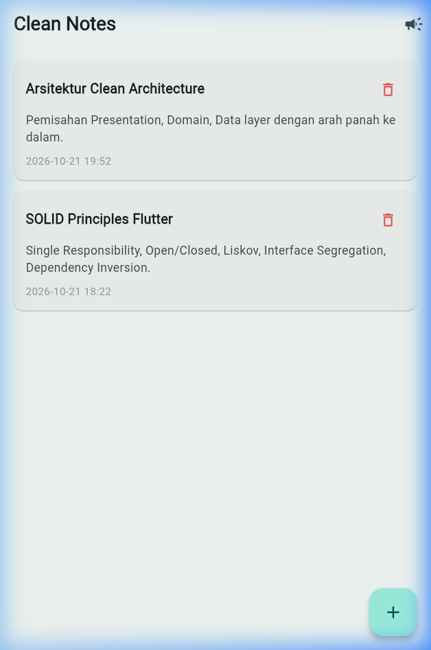
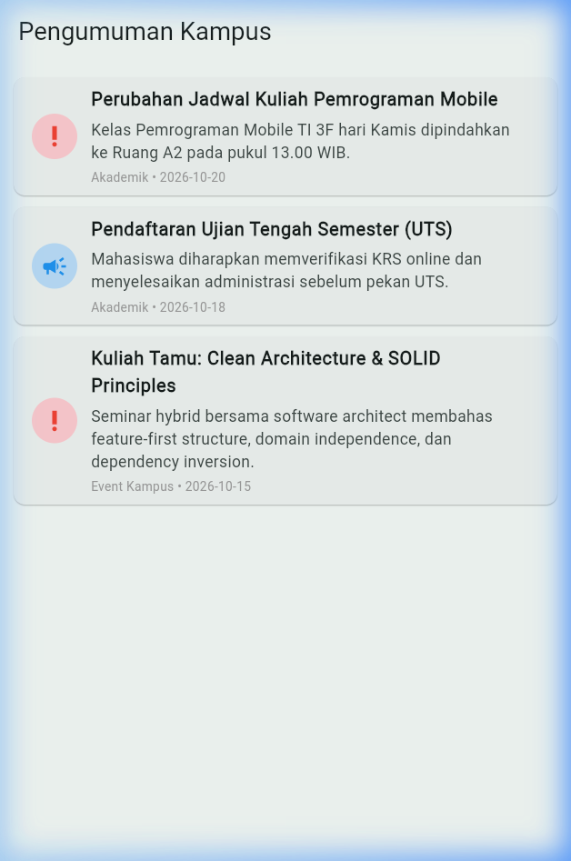
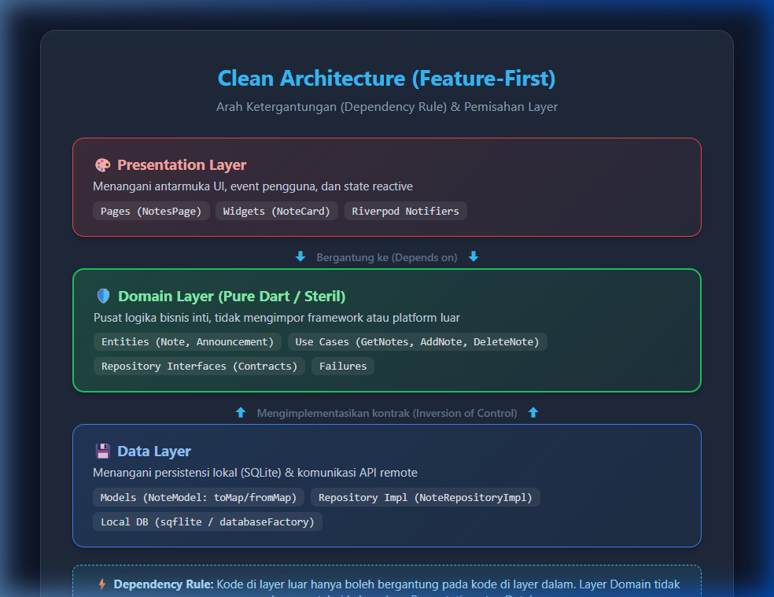
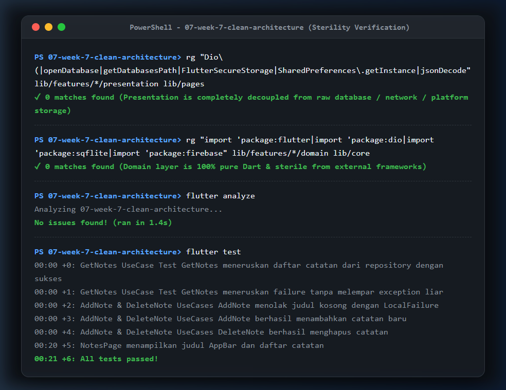

# Praktikum 7 - Clean Architecture (Feature-First)

Project Flutter ini berisi implementasi arsitektur perangkat lunak **Clean Architecture** dengan pendekatan modular **Feature-First**. Menggabungkan penerapan prinsip-prinsip **SOLID**, pemisahan ketat tiga layer (*Presentation, Domain, Data*), pemenuhan aturan dependensi (*Dependency Rule*), abstraksi entitas bisnis murni, *Use Case*, dan *Dependency Injection* menggunakan Riverpod.

---

## Identitas Mahasiswa

| Data | Keterangan |
|---|---|
| **Nama** | Achmad Daud Roichan |
| **NIM** | 244107020005 |
| **Kelas** | TI 3F |
| **Mata Kuliah** | Pemrograman Mobile (Mobile Programming) |
| **Praktikum** | Praktikum 7 - Clean Architecture |

---

## Ringkasan Project

- **Pendekatan Modular (Feature-First):** Membagi kode berdasarkan fitur fungsional (`features/notes/` dan `features/announcements/`) daripada membaginya secara global antar-layer. Setiap fitur membungkus ketiga layernya sendiri (*domain, data, presentation*).
- **Aturan Dependensi (Dependency Rule):** Dependensi kode hanya mengarah ke dalam:
  ```text
  Presentation (UI, Notifier, Widget)
         │
         ▼  (bergantung ke)
  Domain (Entity, Repository Interface, Use Case, Failure)
         ▲
         │  (diimplementasikan oleh)
  Data (Model, Repository Impl, SQLite / Data Source)
  ```
- **Domain Layer Steril:** Layer domain sepenuhnya murni (*pure Dart*), tidak mengimpor `flutter`, `dio`, `sqflite`, maupun `firebase`.
- **Entity vs Model:** `Note` pada domain merupakan entitas bisnis murni tanpa serialisasi. Konversi `toMap()`, `fromMap()`, dan `toEntity()` sepenuhnya diisolasi di `NoteModel` pada data layer.
- **Dependency Injection (DI) Terpusat:** Widget dan Notifier tidak pernah menginstansiasi repositori secara mandiri dengan kata kunci `new`. Semua dependensi disuntikkan secara terstruktur melalui provider Riverpod.

---

## Struktur Project

```text
07-week-7-clean-architecture/
├── README.md
├── analysis_options.yaml
├── pubspec.yaml
├── docs/
│   └── ai_challenge.md
├── screenshots/
│   ├── clean_notes_page.png
│   ├── clean_announcements_page.png
│   ├── clean_architecture_diagram.png
│   └── sterility_grep_check.png
├── lib/
│   ├── main.dart
│   ├── routes.dart
│   ├── core/
│   │   ├── failures.dart
│   │   └── format.dart
│   └── features/
│       ├── notes/
│       │   ├── domain/
│       │   │   ├── entities/note.dart
│       │   │   ├── repositories/note_repository.dart
│       │   │   └── usecases/
│       │   │       ├── add_note.dart
│       │   │       ├── delete_note.dart
│       │   │       └── get_notes.dart
│       │   ├── data/
│       │   │   ├── models/note_model.dart
│       │   │   └── repositories/note_repository_impl.dart
│       │   └── presentation/
│       │       ├── pages/notes_page.dart
│       │       ├── providers/notes_providers.dart
│       │       └── widgets/note_card.dart
│       └── announcements/
│           ├── domain/
│           │   ├── entities/announcement.dart
│           │   ├── repositories/announcement_repository.dart
│           │   └── usecases/get_announcements.dart
│           ├── data/
│           │   ├── models/announcement_model.dart
│           │   └── repositories/announcement_repository_impl.dart
│           └── presentation/
│               ├── pages/announcements_page.dart
│               └── providers/announcement_providers.dart
└── test/
    ├── get_notes_test.dart
    └── widget_test.dart
```

---

## Prinsip SOLID dalam Implementasi Flutter

| Prinsip SOLID | Arti Praktis | Contoh Penerapan di Project Ini |
|---|---|---|
| **S** - Single Responsibility Principle | Sebuah kelas hanya boleh memiliki satu alasan untuk berubah. | `NoteCard` hanya merender tampilan; pemformatan waktu didelegasikan ke `core/format.dart`, dan logika penyimpanan ke `NoteRepository`. |
| **O** - Open/Closed Principle | Terbuka untuk ekstensi, tertutup untuk modifikasi. | Menambahkan sumber data baru (misal: Firebase/REST API) cukup membuat `NoteRemoteRepositoryImpl` baru tanpa mengubah kode di `domain` atau `presentation`. |
| **L** - Liskov Substitution Principle | Subkelas/implementasi harus dapat menggantikan kontrak induk tanpa merusak sistem. | `FakeNoteRepository` pada unit test dapat menggantikan `NoteRepositoryImpl` seutuhnya tanpa menyebabkan crash atau pelanggaran kontrak. |
| **I** - Interface Segregation Principle | Klien tidak boleh dipaksa bergantung pada antarmuka yang tidak digunakannya. | Interface `NoteRepository` dan `AnnouncementRepository` dipisah tegas ke masing-masing fiturnya, tidak digabung menjadi satu interface raksasa. |
| **D** - Dependency Inversion Principle | Modul tingkat tinggi tidak boleh bergantung pada modul tingkat rendah; keduanya harus bergantung pada abstraksi. | `GetNotes` usecase dan `notes_providers` hanya bergantung pada abstract class `NoteRepository`, bukan implementasi konkret `NoteRepositoryImpl`. |

---

## Bukti Uji Sterilitas Layer (Grep Checks)

Untuk menjamin aturan *Clean Architecture* tidak dilanggar, dilakukan tiga pemeriksaan grep di terminal:

### 1. Presentation Steril dari Akses Data Mentah (Target: 0 Hasil)
```powershell
rg "Dio\(|openDatabase|getDatabasesPath|FlutterSecureStorage|SharedPreferences\.getInstance|jsonDecode" lib/features/*/presentation lib/pages
```
**Hasil:** `0 temuan (bersih)` — Tidak ada widget atau presentation notifier yang menyentuh database, JSON mentah, atau storage platform langsung.

### 2. Domain Steril dari Framework & Package Luar (Target: 0 Hasil)
```powershell
rg "import 'package:flutter|import 'package:dio|import 'package:sqflite|import 'package:firebase" lib/features/*/domain lib/core
```
**Hasil:** `0 temuan (bersih)` — Seluruh layer domain dan core sepenuhnya murni bahasa Dart tanpa keterikatan framework UI atau library pihak ketiga.

### 3. Static Analyzer & Pengujian Unit
```powershell
flutter analyze
flutter test
```
**Hasil:**
- `flutter analyze: No issues found!`
- `flutter test: All tests passed! (6 tests passed)`

---

## Dokumentasi Screenshot

### 1. Fitur Utama: Catatan Bersih (Clean Notes)
Menampilkan daftar catatan yang dikelola melalui Use Case domain dan disuntikkan secara reaktif via Riverpod:

<p align="center">
  
</p>

### 2. Fitur Kedua: Pengumuman Kampus (Clean Announcements)
Implementasi lengkap arsitektur feature-first pada fitur kedua, memisahkan domain entity, repository interface, use case, dan model data:

<p align="center">
  
</p>

### 3. Diagram Arah Dependensi Clean Architecture
Visualisasi struktur layer dan arah panah dependensi yang mengarah ke dalam (*Dependency Inversion*):

<p align="center">
  
</p>

### 4. Hasil Uji Sterilitas Grep & Test Runner
Terminal verifikasi statis yang membuktikan sterilitas domain dan presentation serta kelulusan seluruh unit test:

<p align="center">
  
</p>

---

## AI Prompt Challenge & Verifikasi

Dokumentasi lengkap AI Challenge tersimpan pada file [`docs/ai_challenge.md`](docs/ai_challenge.md).

### Temuan Verifikasi Teknis:
1. **Pemisahan Model vs Entity:** Verifikasi memastikan tidak ada `toMap/fromMap` di entitas `domain/entities/note.dart`.
2. **Pragmatic Use Case vs Over-Engineering:** Operasi penambahan catatan (`AddNote`) mewajibkan Use Case karena membawa aturan validasi bisnis (judul tidak boleh kosong), sedangkan penghapusan sederhana didelegasikan secara terstruktur tanpa boilerplate berlebih.
3. **Penyuntikan Dependensi Murni:** Memanfaatkan Riverpod bawaan (`Provider<NoteRepository>`) tanpa memerlukan library DI tambahan pihak ketiga seperti `get_it` atau `injectable`.

---

## Jawaban Pertanyaan Analisis & Refleksi

### 1. Mengapa interface repository harus tinggal di domain, bukan di data? Apa yang rusak bila dibalik?
> **Jawaban:**
> - **Prinsip Dependency Inversion:** Dalam Clean Architecture, domain adalah pusat aturan bisnis yang tidak boleh bergantung pada hal luar (*core business policy should not depend on technical details*). Dengan menaruh interface repository di `domain`, domain-lah yang mendikte kebutuhan data ("Saya butuh fungsi `fetchNotes()` yang mengembalikan list entitas `Note`").
> - **Apa yang rusak bila dibalik (interface ditaruh di data)?**
>   1. **Arah dependensi terbalik:** Domain akan terpaksa mengimpor layer `data` untuk membaca interface tersebut. Hal ini melanggar *Dependency Rule*.
>   2. **Domain tercemar detail teknis:** Jika data layer diubah dari SQLite ke Firestore atau REST API, domain ikut terkompilasi ulang dan berisiko rusak.
>   3. **Sulit diuji:** Unit testing logika bisnis domain tidak lagi independen karena terikat dengan struktur layer data luar.

### 2. Kapan use case benar-benar dibutuhkan, dan kapan repository langsung ke notifier sudah cukup?
> **Jawaban:**
> - **Use Case Benar-benar Dibutuhkan:**
>   1. Terdapat **logika atau aturan validasi bisnis** sebelum/sesudah data disimpan (contoh: pada `AddNote`, judul harus divalidasi tidak boleh kosong atau minimal 3 karakter; atau memformat string input).
>   2. Terdapat **orkestrasi multi-repositori** (contoh: Use Case `SyncNotes` yang membaca catatan lokal dari `NoteRepository` lalu mengirimkannya ke `RemoteApiRepository` dan memperbarui stempel waktu sinkronisasi).
>   3. Logika bisnis tersebut perlu digunakan ulang (*reusable*) di beberapa halaman atau widget yang berbeda.
> - **Repository Langsung ke Notifier Cukup:**
>   - Pada operasi CRUD pasif 1-baris tanpa validasi apa pun (contoh: `deleteNote(id)` atau query paginasi sederhana). Memaksakan Use Case untuk operasi 1-baris tanpa aturan bisnis hanya memindahkan baris kode (*forwarding method*) dan merupakan bentuk *over-engineering*.

### 3. Apa biaya over-engineering (use case per CRUD satu-baris) bagi tim kecil? Kapan biayanya sepadan?
> **Jawaban:**
> - **Biaya bagi Tim Kecil:**
>   - **Penurunan Kecepatan Rilis (Velocity):** Setiap penambahan field atau operasi sederhana memerlukan pembuatan/pengubahan 5-7 file sekaligus (*Entity, Model, Repository Interface, Repository Impl, Use Case, Provider, Page*).
>   - **Beban Kognitif Tinggi (*Cognitive Load*):** Navigasi proyek menjadi lambat karena terlalu banyak berkas pembungkus (*wrapper files*) yang hanya melakukan *pass-through*.
> - **Kapan Biayanya Sepadan?**
>   - Ketika tim bertambah besar (>5-10 developer) yang bekerja secara paralel pada fitur yang sama.
>   - Ketika aplikasi memiliki aturan bisnis yang kompleks, regulasi ketat (fintech/medis), atau arsitektur multi-platform yang berencana mengganti framework UI tanpa mengubah logika bisnis.

### 4. Bagian mana dari usulan AI yang Anda tolak atau sederhanakan, dan mengapa?
> **Jawaban:**
> - **Menolak Penggunaan Third-Party Service Locator:** AI sempat menyarankan menambahkan package `get_it` dan `injectable` untuk dependency injection. Kami tolak karena project sudah menggunakan `flutter_riverpod`. Riverpod secara bawaan adalah container DI yang *type-safe*, *declarative*, dan mudah di-*override* pada pengujian unit tanpa menambah boilerplate *service locator*.
> - **Menolak Use Case untuk Setiap Getter Pasif:** AI mengusulkan use case terpisah `CountDirtyNotes`, `GetNoteById`, `GetLastOpened`. Kami sederhanakan agar query pasif langsung diakses via repositori terabstraksi, menjaga kode tetap ringkas dan mudah dipelihara.

---

## Cara Menjalankan Project

1. Masuk ke direktori project Week 7:
   ```powershell
   cd 07-week-7-clean-architecture
   ```
2. Unduh dependensi:
   ```powershell
   flutter pub get
   ```
3. Jalankan pengujian statis dan unit:
   ```powershell
   flutter analyze
   flutter test
   ```
4. Jalankan aplikasi pada browser / emulator:
   ```powershell
   flutter run
   ```

---

## Hasil Verifikasi

Hasil eksekusi analizer dan test runner:

```text
flutter analyze: No issues found!
flutter test: All tests passed! (6 tests passed)
```

Daftar test yang terverifikasi lulus:
- `GetNotes UseCase Test GetNotes meneruskan daftar catatan dari repository dengan sukses`
- `GetNotes UseCase Test GetNotes meneruskan failure tanpa melempar exception liar`
- `AddNote & DeleteNote UseCases AddNote menolak judul kosong dengan LocalFailure`
- `AddNote & DeleteNote UseCases AddNote berhasil menambahkan catatan baru`
- `AddNote & DeleteNote UseCases DeleteNote berhasil menghapus catatan`
- `Widget test NotesPage menampilkan judul AppBar dan daftar catatan`

---

## Referensi

- [Slide Week 7: Clean Architecture](https://jti-polinema.github.io/flutter-codelab/00-slides/Week_07_Clean_Architecture.html)
- [Codelab Week 7 - Clean Architecture](https://jti-polinema.github.io/flutter-codelab/07-minggu-7-clean-architecture/)
- [The Clean Code Blog: Clean Architecture (Robert C. Martin)](https://blog.cleancoder.com/uncle-bob/2012/08/13/the-clean-architecture.html)
- [Flutter App Architecture Guide](https://docs.flutter.dev/app-architecture/guide)
- [Riverpod Providers & DI](https://riverpod.dev/docs/concepts/providers)
